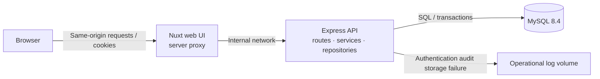
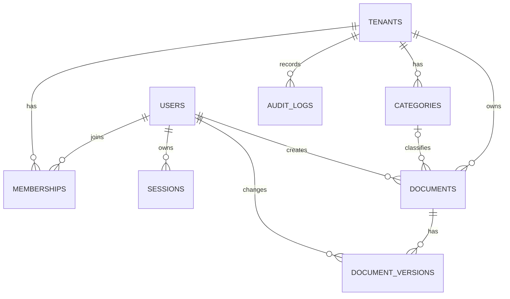

# Portfolio — Organization Document Workspace

[한국어](README.md) | English

A multi-tenant MVP for securely sharing documents within organizations, with role-based access and change history.

> **Current status:** Core document features and the local demo are implemented. Requirements for public deployment, including safe demo reset and expired-data cleanup, are incomplete; do not operate this as a public service.

## Overview and Motivation

When multiple organizations use the same service, they must not be able to access each other's documents, and concurrent edits must not lose change history. Using team guides and FAQs as its scenario, this project addresses:

- Isolating organizational data and operations using active memberships and roles.
- Saving document changes together with version history and notifying users of edit conflicts.
- Verifying isolation, failure paths and user flows against real MySQL, API and browser instances.
- Maintaining guidance and evaluation cases for a specification → implementation → testing loop.

Organization creation, invitations, attachments and real-time collaboration are outside the MVP. See the [MVP specification](specs/multitenant-mvp.md) for policies and the [implementation checklist](specs/multitenant-mvp-checklist.md) for progress.

## Features and Status

| Feature                       | Status      | Details                                                                                                                                                             |
| ----------------------------- | ----------- | ------------------------------------------------------------------------------------------------------------------------------------------------------------------- |
| Authentication and security   | Implemented | Signup, login and logout, DB sessions, CSRF, Origin checks, rate limiting and authentication audit                                                                  |
| Organizations and permissions | Implemented | Active membership checks, owner/admin/editor/viewer roles and cross-organization access protection                                                                  |
| Documents and versions        | Implemented | Create, read and update documents; initial and change history; revision-based conflict detection                                                                    |
| Categories and recovery       | Implemented | Category management, document trash, document and past-version restoration                                                                                          |
| Search and preview            | Implemented | Korean substring search in titles and bodies, safe Markdown preview                                                                                                 |
| Members and audit             | Implemented | Role and status changes, atomic successful changes and audit records, authorization-denial audit                                                                    |
| Local role demo               | Implemented | Four role accounts and ten example documents per role, 40 shared documents in total                                                                                 |
| Operations                    | Partial     | Audit retention cleanup command and backup/restore procedure are available; safe demo reset, automatic expired-data cleanup and public deployment remain incomplete |

All four roles can read documents; only owner, admin and editor can create or edit them. Member management depends on the target and assigned roles, and member changes are blocked in demo organizations. Documents attributed to the viewer in the role demo are seed fixtures and do not grant viewer write access.

## Technology Stack and Rationale

| Area               | Technology                            | Rationale                                                                                  |
| ------------------ | ------------------------------------- | ------------------------------------------------------------------------------------------ |
| Frontend           | Nuxt 4, Vue 3, TypeScript             | Combine the UI and server proxy while forwarding browser requests through the same origin  |
| Backend            | Node.js 24 LTS, Express 5, TypeScript | Explicit API layers and type-based development alongside the frontend                      |
| Database           | MySQL 8.4, mysql2, SQL                | Work directly with transactions, locks and composite foreign keys to verify data integrity |
| Local environment  | Docker Compose                        | Separate web, API and DB services with health checks and persistent volumes                |
| Quality            | Vitest, Playwright, ESLint, Prettier  | Separate unit, integration, real-browser and static checks by purpose                      |
| Package management | pnpm workspace                        | Manage app and verification dependencies and commands in one repository                    |

See the [stack decision](docs/decisions/001-stack-and-quality-tooling.md) for details and versions. `packages/shared/` is reserved for framework-independent code and is not yet a separate package.

## System Architecture



- The browser uses Nuxt's same-origin paths; the Nuxt server forwards requests to the API.
- The API checks authentication and organization permissions before accessing MySQL. Sessions and rate-limit data are also stored in the database.
- Compose starts MySQL, then the API, then the web app, waiting for health checks. Database data and authentication audit failure logs use separate volumes.
- This local configuration is not a production deployment. See [API configuration](apps/api/README.md) for proxy trust boundaries and operational constraints.

## Database Design

This simplified ERD shows the core relationships. See the [initial migration](apps/api/migrations/001_initial.sql) and [authentication migration](apps/api/migrations/002_authentication.sql) for all columns and constraints.



- `memberships` connects users and organizations and stores roles and active status.
- `documents` stores current content, `content_version` and `revision`; `document_versions` stores change snapshots.
- Composite foreign keys containing `tenant_id` prevent invalid cross-organization document–category and version–document references. Access control is performed separately through tenant-scoped queries and authorization checks.

## Key Technical Decisions

### Tenant Isolation and Error Precedence

An organization slug alone does not grant access: each request verifies active membership. Document and history queries are scoped to the verified organization; resources in another organization or missing resources return `404`. Insufficient permissions for a resource in the same organization return `403`. Composite foreign keys protect data relationships but do not replace user authorization.

### Document Versions and Concurrency

`content_version` identifies a content-history version, while `revision` detects conflicts across state changes, including deletion and recovery. Creation or updates and their history records commit in the same transaction. An outdated revision returns `409` even if the submitted content matches; a valid no-op preserves the version, revision and update time. The UI preserves the user's input when a conflict occurs.

### Audit Boundaries

A successful member change and its audit record share a transaction, so an audit write failure rolls back the change. Authorization denials are recorded separately from the rejected business transaction. Audit failure policies for login and logout differ and are specified in the [authentication contract](specs/auth-api.md).

### Search and Safe Rendering

Search uses literal substring matching in titles and Markdown bodies. For example, `휴가` matches `연차 및 휴가 신청`, but initial-consonant matching and typo correction are not supported. The preview renders only allowed Markdown and does not render raw HTML, images or unsafe links. See the [search and preview contract](specs/search-preview.md) for details.

## Troubleshooting and Performance Considerations

| Problem                                                                                           | Response and verification                                                                                                                                                           | Evidence                                                                                                        |
| ------------------------------------------------------------------------------------------------- | ----------------------------------------------------------------------------------------------------------------------------------------------------------------------------------- | --------------------------------------------------------------------------------------------------------------- |
| Concurrent edits could overwrite changes or leave history inconsistent                            | Check revision first and save the document change and history in one transaction. Verify that only one competing request succeeds and a history write failure rolls back the change | [Document API contract](specs/documents-api.md), [implementation checklist](specs/multitenant-mvp-checklist.md) |
| Category status displayed incorrectly when the MySQL driver returned a numeric status as a string | Handle both numeric and string statuses and reverify with real MySQL and browser flows                                                                                              | [Checklist: categories and recovery](specs/multitenant-mvp-checklist.md)                                        |
| Search failed when it was the first request to a new API instance because of route registration   | Fix route registration and run real MySQL and browser regression checks                                                                                                             | [Checklist: members, search and UI](specs/multitenant-mvp-checklist.md)                                         |
| Cost of arbitrary substring search                                                                | Use the existing listing index containing tenant and deletion state, while recognizing that body substring matching may scan the tenant's active documents                          | [Search plan and limitations](specs/search-preview.md)                                                          |

`EXPLAIN` selected the listing index in a small isolated database, but no representative performance benchmark or response-time improvement was measured. Reassess with realistic data before scaling.

## Installation and Local Setup

### Prerequisites

- Docker and Docker Compose
- Node.js 24.15 or later and pnpm 10.30.0 for local development and tests
- Available host ports `3000`, `4000` and `3307`

Run these commands from the repository root in Bash. If a database already exists, confirm the target database and read the [migration recovery procedure](apps/api/migrations/README.md) before applying migrations or seeds.

```bash
pnpm install --frozen-lockfile
if [ ! -e .env ]; then cp .env.example .env; fi
pnpm docker:up
docker compose ps
docker compose exec -T api node apps/api/dist/cli/migrate.js
```

The `.env` defaults are for local development only. MySQL initializes its database and user when the volume is first created; changing `.env` alone does not update an existing volume's credentials.

### Role Demo Data

On the first run, enter a password for local use. Input is hidden, so the password is not typed into shell command history.

```bash
read -rs -p "Demo password (12–128 characters): " SEED_DEMO_PASSWORD
echo
export SEED_DEMO_PASSWORD
docker compose exec -T -e SEED_DEMO_PASSWORD api node apps/api/dist/cli/role-demo-seed.js
unset SEED_DEMO_PASSWORD
```

| Role   | Login email                 |
| ------ | --------------------------- |
| Owner  | `owner@roles.demo.invalid`  |
| Admin  | `admin@roles.demo.invalid`  |
| Editor | `editor@roles.demo.invalid` |
| Viewer | `viewer@roles.demo.invalid` |

All four accounts use the password entered when the seed runs. Sign in on the [login page](http://localhost:3000/login), then select **조직과 문서 보기 → 역할별 데모**. All 40 documents are shared within the same organization.

The seed runs only once; rerunning it does not change existing data or passwords. Name collisions fail without overwriting existing records. Do not use a rerun to reset an unknown or existing database password. See the [API README](apps/api/README.md) for local database configuration and the separate seed that creates two other organizations.

The web app is at `http://localhost:3000`, the API at `http://localhost:4000`, and MySQL at `127.0.0.1:3307`. `pnpm docker:down` stops services but keeps the DB volume. `docker compose down -v` deletes volumes; do not run it if the data must be preserved.

## API Documentation and Tests

The API uses `/api/v1`; state-changing requests require a CSRF token and the configured Origin. See the contracts for requests, responses, permissions and error codes.

| Contract                                                | Coverage                                                    |
| ------------------------------------------------------- | ----------------------------------------------------------- |
| [Authentication API](specs/auth-api.md)                 | Signup, login, sessions, logout and CSRF                    |
| [Organization and document API](specs/documents-api.md) | Organization listing, document CRUD, revision and history   |
| [Category and recovery API](specs/recovery-api.md)      | Categories, trash and version restoration                   |
| [Member and audit API](specs/members-api.md)            | Member role and status changes, audit access                |
| [Search and preview](specs/search-preview.md)           | Search conditions, pagination and Markdown rendering policy |

| Command                                    | Coverage                                                                                     |
| ------------------------------------------ | -------------------------------------------------------------------------------------------- |
| `pnpm verify`                              | Formatting, lint, type-check, unit and general integration tests, and evaluations            |
| `pnpm test:unit` / `pnpm test:integration` | Unit / general integration tests respectively                                                |
| `pnpm test:integration:mysql`              | Authentication, tenant isolation, concurrency, rollback and more against isolated real MySQL |
| `pnpm test:e2e`                            | Browser tests using a health fixture                                                         |
| `pnpm test:e2e:auth`                       | Authentication browser flow through the real API and MySQL                                   |
| `pnpm test:e2e:documents`                  | Document browser flow through the real API and MySQL                                         |

`pnpm verify` does not include real-MySQL integration tests or browser E2E tests. Real DB tests require a **separate dedicated database** named with the `portfolio_test_` prefix and `TEST_DB_*` environment variables. Browser tests require separate ports, Chromium and system libraries. See the [integration test guide](tests/integration/README.md) and [browser test guide](tests/e2e/README.md) for setup and execution requirements.

## Deployment and CI/CD

The available deployment configuration is local Docker Compose. There is no public deployment URL or automated deployment pipeline.

[GitHub Actions CI](.github/workflows/ci.yml) is configured on pushes and pull requests to run `pnpm verify`, isolated MySQL integration tests, and a document browser test using the real API and DB. The dedicated authentication browser test is a separate command and is not currently included in CI. Remote CI results must be verified separately.

## Retrospective and Next Steps

The priority is not feature count, but **explaining and verifying tenant isolation, document/history atomicity, conflicts and failure paths against a real database**. Specifications and API contracts are connected first, and unit, integration and browser checks are separated so their evidence is clear.

- Before public deployment, implement and verify demo reset, races with user writes and session creation, recovery after failure, and protection of ordinary data.
- Add automatic cleanup of expired sessions, CSRF and rate-limit data, plus operational monitoring.
- Improve the user experience for unsaved input, organization switching, member-fetch races and errors after saving.
- Measure search performance with representative data and revisit the search strategy when needed.

## Repository Layout

| Path                     | Purpose                                                                                  |
| ------------------------ | ---------------------------------------------------------------------------------------- |
| `apps/api/`              | Express API, SQL migrations and database operations                                      |
| `apps/webs/`             | Nuxt web UI and server proxy                                                             |
| `packages/shared/`       | Reserved space for framework-independent shared code                                     |
| `specs/`                 | Feature policies, API contracts and implementation checklist                             |
| `docs/`                  | Architecture, technical decisions, operations and [harness reuse](docs/harness-reuse.md) |
| `tests/`, `evals/cases/` | Purpose-specific tests and deterministic regression evaluations                          |
| `.github/`               | CI and coding-agent instructions and skills                                              |
