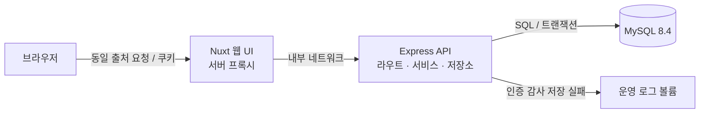
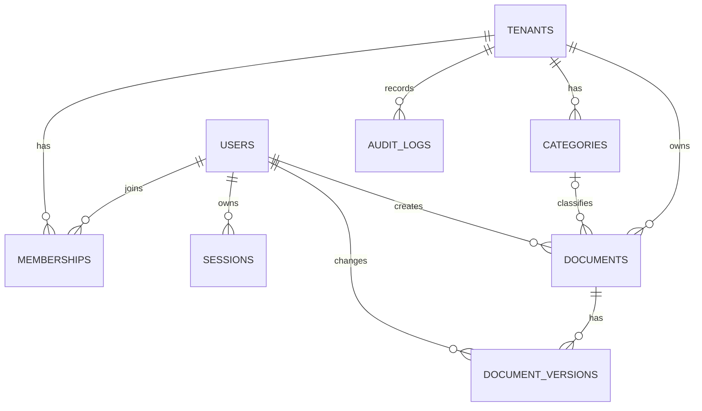

# Portfolio — 조직별 문서 공유 워크스페이스

한국어 | [English](README.en.md)

조직마다 문서를 안전하게 공유하고, 역할별 권한과 변경 이력을 관리하는 멀티테넌트 MVP입니다.

> **현재 상태:** 핵심 문서 기능과 로컬 데모는 구현되어 있습니다. 안전한 데모 초기화와 만료 데이터 정리 등 공용 배포 조건은 아직 완료되지 않았으므로 공개 서비스로 운영하지 않습니다.

## 프로젝트 개요 및 개발 목적

여러 조직이 같은 서비스를 이용할 때는 다른 조직의 문서를 볼 수 없어야 하고, 같은 문서를 동시에 수정해도 변경 이력이 유실되지 않아야 합니다. 이 프로젝트는 팀의 업무 가이드와 FAQ를 공유하는 시나리오를 통해 다음 문제를 다룹니다.

- 활성 멤버십과 역할을 기준으로 조직별 데이터와 작업 권한을 분리합니다.
- 문서 변경과 버전 기록을 함께 저장하고, 동시 수정 충돌을 사용자에게 알립니다.
- 실제 MySQL, API와 브라우저를 연결해 격리·실패·사용자 흐름을 검증합니다.
- 명세 → 구현 → 테스트의 반복을 지원하는 평가 사례를 함께 관리합니다.

조직 생성, 초대, 첨부파일, 실시간 협업은 MVP 범위 밖입니다. 전체 정책은 [MVP 명세](specs/multitenant-mvp.md), 단계별 상태는 [구현 체크리스트](specs/multitenant-mvp-checklist.md)를 참고하세요.

## 주요 기능과 구현 상태

| 기능             | 상태      | 내용                                                                                                        |
| ---------------- | --------- | ----------------------------------------------------------------------------------------------------------- |
| 인증과 보안      | 구현      | 회원가입, 로그인·로그아웃, DB 세션, CSRF, Origin 검사, 요청 제한 및 인증 감사                               |
| 조직과 권한      | 구현      | 활성 멤버십 확인, owner·admin·editor·viewer 역할, 다른 조직의 리소스 접근 차단                              |
| 문서와 버전      | 구현      | 문서 생성·조회·수정, 최초·변경 이력, revision 기반 충돌 검사                                                |
| 카테고리와 복구  | 구현      | 카테고리 관리, 문서 휴지통, 문서 및 과거 버전 복원                                                          |
| 검색과 미리보기  | 구현      | 제목·본문의 한국어 부분 일치 검색, 안전한 Markdown 미리보기                                                 |
| 멤버와 감사      | 구현      | 역할·상태 변경, 성공 변경과 감사 기록의 원자적 저장, 권한 거부 감사                                         |
| 역할별 로컬 데모 | 구현      | 네 역할 계정과 역할별 예시 문서 10개씩, 총 40개 공유                                                        |
| 운영             | 일부 구현 | 감사 보존 정리 명령과 백업·복구 절차는 마련; 안전한 데모 초기화, 만료 데이터 자동 정리와 공용 배포는 미완료 |

네 역할 모두 문서를 읽을 수 있으며 owner·admin·editor만 문서를 작성·수정할 수 있습니다. 멤버 관리는 대상과 지정 역할에 따라 제한되며 데모 조직의 멤버 변경은 차단됩니다. 역할별 데모의 viewer 명의 문서는 seed로 생성한 예시이며 viewer에게 쓰기 권한을 부여하지 않습니다.

## 기술 스택과 선택 이유

| 영역         | 기술                                  | 선택 이유                                                           |
| ------------ | ------------------------------------- | ------------------------------------------------------------------- |
| 프론트엔드   | Nuxt 4, Vue 3, TypeScript             | 화면과 서버 프록시를 함께 구성하고 브라우저 요청을 동일 출처로 전달 |
| 백엔드       | Node.js 24 LTS, Express 5, TypeScript | 명시적인 API 계층과 프론트엔드에서 함께 사용하는 타입 기반 개발     |
| 데이터베이스 | MySQL 8.4, mysql2, SQL                | 트랜잭션, 잠금과 복합 외래 키를 직접 다루고 데이터 무결성을 검증    |
| 로컬 환경    | Docker Compose                        | 웹·API·DB를 분리하고 health check 및 영속 볼륨으로 재현             |
| 품질 검증    | Vitest, Playwright, ESLint, Prettier  | 단위·통합·실제 브라우저 흐름과 정적 검사를 목적별로 분리            |
| 패키지 관리  | pnpm workspace                        | 앱과 검증 도구의 의존성 및 명령을 한 저장소에서 관리                |

상세 근거와 버전은 [기술 스택 결정](docs/decisions/001-stack-and-quality-tooling.md)을 참고하세요.

## 시스템 아키텍처



- 브라우저는 Nuxt의 동일 출처 경로를 이용하고, Nuxt 서버가 API로 요청을 전달합니다.
- API는 인증과 조직별 권한을 검사한 뒤 MySQL에 접근합니다. 세션과 요청 제한 정보도 DB에 저장합니다.
- Compose는 MySQL → API → 웹 순으로 health check를 통과한 뒤 서비스를 시작합니다. DB와 인증 감사 실패 로그는 각각 별도 볼륨에 보관합니다.
- 로컬 구성은 프로덕션 배포 구성이 아닙니다. 프록시 신뢰 경계와 운영상 제약은 [API 운영 설정](apps/api/README.md)에 정리되어 있습니다.

## 데이터베이스 설계

다음은 핵심 관계를 간략화한 ERD입니다. 전체 컬럼과 제약은 [초기 migration](apps/api/migrations/001_initial.sql)과 [인증 migration](apps/api/migrations/002_authentication.sql)을 참고하세요.



- `memberships`는 사용자와 조직을 연결하고 역할과 활성 상태를 보관합니다.
- `documents`는 현재 내용과 `content_version`, `revision`을, `document_versions`는 변경 스냅샷을 보관합니다.
- 문서–카테고리와 이력–문서 관계는 `tenant_id`를 포함한 복합 외래 키로 조직 간 잘못된 참조를 방지합니다. 접근 제어는 별도의 테넌트 범위 조회와 권한 검사로 수행합니다.

## 주요 기술적 의사결정

### 테넌트 격리와 오류 우선순위

조직 slug만으로 접근을 허용하지 않고 매 요청마다 활성 멤버십을 확인합니다. 문서·이력은 확인된 조직 범위에서 조회하며, 다른 조직 또는 없는 리소스는 `404`로 처리합니다. 같은 조직의 리소스에 대한 권한 부족은 `403`입니다. DB의 복합 외래 키는 데이터 관계를 보호하지만 사용자 권한 검사를 대신하지 않습니다.

### 문서 버전과 동시성

`content_version`은 콘텐츠 이력의 버전이고 `revision`은 삭제·복구를 포함한 상태 변경의 충돌 검사 값입니다. 생성·수정과 이력 저장은 같은 트랜잭션에서 커밋합니다. 오래된 revision은 내용이 같아도 먼저 `409`로 거부하며, 유효한 변경 없는 저장은 버전·revision·수정 시각을 유지합니다. 충돌 시 화면에 입력한 내용은 보존합니다.

### 감사 기록의 경계

멤버 변경 성공과 감사 기록은 같은 트랜잭션으로 처리해 감사 저장 실패 시 변경을 롤백합니다. 권한 거부는 거부된 업무 트랜잭션과 별도로 기록합니다. 로그인·로그아웃의 감사 실패 정책은 각각 다르며 [인증 계약](specs/auth-api.md)에 명시되어 있습니다.

### 검색과 안전한 표시

검색은 제목과 Markdown 본문의 리터럴 부분 일치입니다. 예를 들어 `휴가`로 `연차 및 휴가 신청`을 찾을 수 있지만 초성 검색과 오타 교정은 제공하지 않습니다. 미리보기는 허용된 Markdown만 렌더링하고 원시 HTML, 이미지 및 위험한 링크를 표시하지 않습니다. 세부 규칙은 [검색·미리보기 계약](specs/search-preview.md)을 참고하세요.

## 트러블슈팅 및 성능 고려

| 문제                                                                     | 대응과 확인                                                                                                                          | 근거                                                                                           |
| ------------------------------------------------------------------------ | ------------------------------------------------------------------------------------------------------------------------------------ | ---------------------------------------------------------------------------------------------- |
| 동시 수정 시 덮어쓰기와 이력 불일치 가능성                               | revision을 먼저 확인하고 문서 변경과 이력 저장을 한 트랜잭션으로 처리. 경합에서 한 요청만 성공하고 이력 저장 실패 시 롤백되는지 검사 | [문서 API 계약](specs/documents-api.md), [구현 체크리스트](specs/multitenant-mvp-checklist.md) |
| MySQL 드라이버가 숫자 상태를 문자열로 반환해 카테고리 상태가 잘못 표시됨 | 숫자와 문자열 상태를 처리하도록 수정하고 실제 MySQL·브라우저 흐름으로 재검증                                                         | [구현 체크리스트: 카테고리·복구](specs/multitenant-mvp-checklist.md)                           |
| 검색이 새 API의 첫 요청일 때 경로 등록 결함 발생                         | 경로 등록을 수정하고 실제 MySQL과 브라우저 회귀 검증                                                                                 | [구현 체크리스트: 멤버·검색·화면](specs/multitenant-mvp-checklist.md)                          |
| 임의 부분 문자열 검색의 비용                                             | 조직·삭제 상태를 포함하는 기존 목록 인덱스를 활용하되, 본문 부분 일치는 조직 내 활성 문서를 스캔할 수 있음                           | [검색 실행 계획과 한계](specs/search-preview.md)                                               |

작은 격리 DB의 `EXPLAIN`에서 목록 인덱스가 선택되었지만, 대표 데이터의 성능 벤치마크나 응답 시간 개선 수치는 측정하지 않았습니다. 규모 확대 전 실제 데이터로 재측정해야 합니다.

## 설치 및 로컬 실행

### 준비 사항

- Docker와 Docker Compose
- Node.js 24.15 이상, pnpm 10.30.0: 로컬 개발과 테스트 실행 시 필요
- 호스트 포트 `3000`, `4000`, `3307` 사용 가능

다음 명령은 저장소 루트와 Bash 기준입니다. 기존 DB가 있다면 migration과 seed 전에 대상 DB와 [migration 복구 절차](apps/api/migrations/README.md)를 확인하세요.

```bash
pnpm install --frozen-lockfile
if [ ! -e .env ]; then cp .env.example .env; fi
pnpm docker:up
docker compose ps
docker compose exec -T api node apps/api/dist/cli/migrate.js
```

`.env`의 기본값은 로컬 개발용입니다. MySQL 사용자와 DB는 볼륨을 처음 만들 때 초기화되므로 기존 볼륨이 있으면 `.env` 변경만으로 계정이 바뀌지 않습니다.

### 역할별 데모 데이터

최초 실행 시 로컬 전용 비밀번호를 직접 입력합니다. 입력은 화면에 표시되지 않으며 셸 명령 이력에 비밀번호를 적지 않습니다.

```bash
read -rs -p "데모 비밀번호 (12~128자): " SEED_DEMO_PASSWORD
echo
export SEED_DEMO_PASSWORD
docker compose exec -T -e SEED_DEMO_PASSWORD api node apps/api/dist/cli/role-demo-seed.js
unset SEED_DEMO_PASSWORD
```

| 역할   | 로그인 이메일               |
| ------ | --------------------------- |
| Owner  | `owner@roles.demo.invalid`  |
| Admin  | `admin@roles.demo.invalid`  |
| Editor | `editor@roles.demo.invalid` |
| Viewer | `viewer@roles.demo.invalid` |

네 계정은 seed 실행 시 입력한 공통 비밀번호를 사용합니다. [로그인 화면](http://localhost:3000/login)에서 로그인한 뒤 **조직과 문서 보기 → 역할별 데모**를 선택하세요. 40개 문서는 같은 조직에서 공유됩니다.

Seed는 한 번만 적용되며 재실행해도 기존 데이터나 비밀번호를 변경하지 않습니다. 이름 충돌 시 기존 데이터를 덮어쓰지 않고 실패합니다. 기존 DB의 비밀번호를 모르거나 변경하려면 재실행을 비밀번호 초기화 수단으로 사용하지 마세요. 기존 두 조직을 만드는 별도 seed와 로컬 DB 설정은 [API README](apps/api/README.md)에 있습니다.

웹은 `http://localhost:3000`, API는 `http://localhost:4000`, MySQL은 `127.0.0.1:3307`에서 접근합니다. `pnpm docker:down`은 서비스를 중지하지만 DB 볼륨은 유지합니다. `docker compose down -v`는 볼륨을 삭제하므로 데이터를 보존해야 한다면 실행하지 마세요.

## API 문서 및 테스트

API는 `/api/v1`을 사용하며 변경 요청에는 CSRF 토큰과 설정된 Origin이 필요합니다. 요청·응답과 권한·오류 코드는 각 계약을 참고하세요.

| 계약                                       | 주요 범위                                   |
| ------------------------------------------ | ------------------------------------------- |
| [인증 API](specs/auth-api.md)              | 가입, 로그인, 세션, 로그아웃, CSRF          |
| [조직·문서 API](specs/documents-api.md)    | 조직 목록, 문서 CRUD, revision, 이력        |
| [카테고리·복구 API](specs/recovery-api.md) | 카테고리, 휴지통, 버전 복원                 |
| [멤버·감사 API](specs/members-api.md)      | 멤버 역할·상태 변경, 감사 조회              |
| [검색·미리보기](specs/search-preview.md)   | 검색 조건, 페이지네이션, Markdown 표시 정책 |

| 명령                                       | 확인 범위                                             |
| ------------------------------------------ | ----------------------------------------------------- |
| `pnpm verify`                              | 포맷, lint, 타입 검사, 단위·일반 통합 테스트 및 평가  |
| `pnpm test:unit` / `pnpm test:integration` | 각각 단위 / 일반 통합 테스트                          |
| `pnpm test:integration:mysql`              | 격리된 실제 MySQL에서 인증·테넌트·동시성·롤백 등 검증 |
| `pnpm test:e2e`                            | health fixture를 사용하는 브라우저 테스트             |
| `pnpm test:e2e:auth`                       | 실제 API·MySQL을 통한 인증 브라우저 흐름              |
| `pnpm test:e2e:documents`                  | 실제 API·MySQL을 통한 문서 브라우저 흐름              |

`pnpm verify`에는 실제 MySQL 통합 테스트와 브라우저 E2E가 포함되지 않습니다. 실제 DB 테스트에는 이름이 `portfolio_test_`로 시작하는 **별도 전용 DB**와 `TEST_DB_*` 환경 변수가 필요합니다. 브라우저 테스트는 별도 포트, Chromium 및 시스템 라이브러리가 필요합니다. 준비와 실행 조건은 [통합 테스트 안내](tests/integration/README.md)와 [브라우저 테스트 안내](tests/e2e/README.md)를 참고하세요.

## 배포 구조 및 CI/CD

현재 제공되는 배포 구성은 로컬 Docker Compose입니다. 공개 배포 주소나 자동 배포 파이프라인은 없습니다.

[GitHub Actions CI](.github/workflows/ci.yml)는 push와 pull request에서 `pnpm verify`, 격리 MySQL 통합 테스트, 실제 API·DB를 이용한 문서 브라우저 테스트를 실행하도록 설정되어 있습니다. 인증 전용 브라우저 테스트는 별도 명령이며 현재 CI 작업에는 포함되지 않습니다. 원격 CI의 실행 결과는 별도 확인이 필요합니다.

## 회고 및 개선 계획

핵심은 기능 수보다 **조직 격리, 문서·이력의 원자성, 충돌과 실패 경로를 실제 DB에서 설명하고 검증하는 것**입니다. 명세와 API 계약을 먼저 연결하고 단위·통합·브라우저 검증을 분리해 각 테스트가 무엇을 증명하는지 명확히 했습니다.

- 공용 배포 전 데모 초기화와 사용자 쓰기·세션 발급 간 경합, 실패 후 복구 및 일반 데이터 보호를 구현·검증합니다.
- 만료 세션·CSRF·요청 제한 데이터의 자동 정리와 운영 모니터링을 마련합니다.
- 저장되지 않은 입력, 조직 전환, 멤버 조회 경합과 저장 후 조회 오류 안내의 사용자 경험을 개선합니다.
- 대표 데이터로 검색 성능을 측정하고 필요할 때 검색 방식을 재검토합니다.

## 저장소 구조

| 경로                     | 역할                                          |
| ------------------------ | --------------------------------------------- |
| `apps/api/`              | Express API, SQL migration, 데이터베이스 작업 |
| `apps/webs/`             | Nuxt 웹 UI와 서버 프록시                      |
| `specs/`                 | 기능 정책, API 계약과 구현 체크리스트         |
| `docs/`                  | 아키텍처, 기술 결정과 운영 절차               |
| `tests/`, `evals/cases/` | 목적별 테스트와 결정적인 회귀 평가            |
| `.github/`               | CI 설정                                       |
